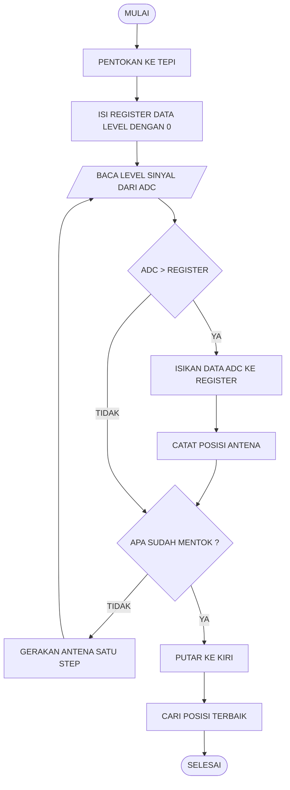

# Portofolio Digital — Ketrampilan Komputer (Kelas TK3B)

Repositori ini merupakan portofolio digital resmi untuk memenuhi tugas **Sesi #13 — Membuat Portofolio Pribadi** pada mata kuliah **Ketrampilan Komputer**, Program Studi Teknik Komputer, Politeknik Negeri Samarinda.

---

## Identitas Mahasiswa

| Atribut | Keterangan |
| :--- | :--- |
| **Nama Mahasiswa** | Muhammad Abid Albhani Pohan |
| **NIM** | `256201048` |
| **Program Studi / Kelas** | Teknik Komputer — TK3B |
| **Institusi** | Politeknik Negeri Samarinda (POLNES) |
| **Dosen Pengampu** | Hari Purwadi |
| **Email** | [muhamadabid06062007@gmail.com](mailto:muhamadabid06062007@gmail.com) |
| **GitHub** | [github.com/synnnn-tra](https://github.com/synnnn-tra) |

---

## 1. Ringkasan Profil (About Me)

Mahasiswa aktif Program Studi **Teknik Komputer** di **Politeknik Negeri Samarinda** dengan ketertarikan kuat pada pengembangan sistem tertanam (*embedded systems* & robotika otonom), analisis data, serta rekayasa perangkat lunak dan kecerdasan buatan (AI/ML). Berpengalaman dalam perancangan rangkaian logika digital, integrasi sensor mikrokontroler (Arduino Uno & ESP32), pengolahan data menggunakan Python/SQL/Excel, serta penyusunan dokumentasi teknis dan ilmiah terstruktur.

---

## 2. Bidang Keahlian & Keterampilan (Skills)

* **Aplikasi Produktivitas & Otomatisasi Kantor:** Microsoft Word (*Mail Merge*, pemformatan dokumen formal), Microsoft Excel (fungsi statistik, pengolahan tabel, visualisasi grafik), Microsoft PowerPoint.
* **Pemodelan Sistem & Dokumentasi:** Perancangan *Flowchart* standar ANSI/ISO (Microsoft Visio, Draw.io, Mermaid.js), dokumentasi teknis berbasis Markdown.
* **Pemrograman & Analisis Data:** Python (Pandas, NumPy, Matplotlib, Scikit-Learn), SQL / MySQL, MATLAB, C/C++, HTML/CSS.
* **Sistem Tertanam & Perangkat Keras:** Mikrokontroler Arduino Uno R3 & ESP32, sensor ultrasonik (HC-SR04), driver motor L298N, rangkaian logika digital (IC TTL 74xx/40xx).
* **Alat Kolaborasi & Kontrol Versi:** Git & GitHub, Google Workspace, VS Code.

---

## 3. Portofolio Proyek Tugas Kuliah Ketrampilan Komputer

Berikut adalah daftar 4 tugas utama yang telah dikerjakan dan terdokumentasi di dalam repositori ini:

| No | Judul Tugas | Teknologi / Alat | Direktori & Tautan Berkas |
| :---: | :--- | :--- | :--- |
| **1** | **Pembuatan Undangan Massal dengan Mail Merge** | Microsoft Word, Microsoft Excel | [`tugas-1-mail-merge/`](./tugas-1-mail-merge/) |
| **2** | **Analisis Data Penjualan Tiket Pesawat (1990–2000)** | Microsoft Excel (`=AVERAGE`, Chart) | [`tugas-2-excel-analisis-data/`](./tugas-2-excel-analisis-data/) |
| **3** | **Penyusunan Presentasi Teknis (Tugas 1 & Tugas 2)** | Microsoft PowerPoint (`.pptx`) | [`tugas-3-presentasi/`](./tugas-3-presentasi/) |
| **4** | **Perancangan Flowchart "Sistem Deteksi Arah"** | Diagram Alir Standar, Mermaid.js | [`tugas-4-flowchart/`](./tugas-4-flowchart/) |

---

### A. Tugas 1 — Pembuatan Undangan Massal Menggunakan Mail Merge
* **Deskripsi:** Merancang sistem otomatisasi surat undangan resmi dengan menghubungkan sumber basis data penerima (`.xlsx`) ke templat dokumen surat (`.docx`) menggunakan fitur **Mail Merge** pada Microsoft Word.
* **Referensi Tutorial:** [Tips Cara Menggunakan Mail Merge di Microsoft Word — Jendela Tutorial](https://youtu.be/8VNH7kgdQSE)
* **Artefak Tersedia:**
  * [`Data_Penerima_Undangan.xlsx`](./tugas-1-mail-merge/Data_Penerima_Undangan.xlsx) — Basis data 10 penerima undangan terstruktur.
  * [`Template_Undangan_Mail_Merge.docx`](./tugas-1-mail-merge/Template_Undangan_Mail_Merge.docx) — Dokumen master undangan dengan *merge fields* (`«Nama»`, `«Jabatan»`, `«Instansi»`, `«Alamat»`, `«Kota»`).
  * [`Dokumentasi Tugas 1`](./tugas-1-mail-merge/README.md)

### B. Tugas 2 — Pengolahan & Analisis Data Penjualan Tiket Pesawat (1990–2000)
* **Deskripsi:** Menyusun dan memformat tabel data penjualan tiket pesawat terbang pada 25 bandara/provinsi di Indonesia selama periode 1990–2000, kemudian menambahkan kolom **Rata-Rata Kota/Bandara** serta baris **Rata-Rata Tahun** menggunakan rumus dinamis `=AVERAGE()`.
* **Ringkasan Hasil Perhitungan:**
  * **Rata-rata penjualan keseluruhan:** `564,47`
  * **3 Bandara dengan rata-rata tertinggi:** Jawa Tengah (`700,55`), Bali (`693,18`), Sumatera Barat (`679,82`)
  * **Bandara dengan rata-rata terendah:** Nusa Tenggara Timur (`456,55`)
  * **Tahun dengan rata-rata tertinggi:** `1999` (`644,72`) | **Terendah:** `1990` (`515,96`)
* **Artefak Tersedia:**
  * [`Praktek1 - Muhammad Abid Albhani Pohan - TK3B.xlsx`](./tugas-2-excel-analisis-data/Praktek1%20-%20Muhammad%20Abid%20Albhani%20Pohan%20-%20TK3B.xlsx)
  * [`Dokumentasi Tugas 2`](./tugas-2-excel-analisis-data/README.md)

### C. Tugas 3 — Media Presentasi Tugas 1 & Tugas 2
* **Deskripsi:** Menyusun bahan presentasi dan memaparkan alur kerja teknis Mail Merge (Tugas 1), pengolahan tabel serta rumus statistik Excel (Tugas 2), dan integrasi keduanya dalam video presentasi.
* **Video Presentasi:** [Tonton di YouTube — Tugas Presentasi 3 (M_ Abid)](https://youtu.be/48dinAQurxY)
* **Artefak Tersedia:**
  * [`Presentasi_Tugas1_dan_Tugas2.pptx`](./tugas-3-presentasi/Presentasi_Tugas1_dan_Tugas2.pptx)
  * [`Dokumentasi Tugas 3`](./tugas-3-presentasi/README.md)

### D. Tugas 4 — Perancangan Flowchart "Sistem Deteksi Arah"
* **Deskripsi:** Menggambar diagram alir (*flowchart*) standar untuk algoritma **Sistem Deteksi Arah** antena berbasis pembacaan level sinyal *Analog-to-Digital Converter* (ADC). Sistem melakukan pemindaian bertahap (*step-by-step*) dari posisi tepi, membandingkan nilai ADC terhadap register maksimum, mencatat posisi sinyal tertinggi hingga batas mentok, lalu memutar antena menuju posisi terbaik.
* **Artefak Tersedia:**
  * [`Flowchart_Sistem_Deteksi_Arah.png`](./tugas-4-flowchart/Flowchart_Sistem_Deteksi_Arah.png)
  * [`flowchart_sistem_deteksi_arah.mmd`](./tugas-4-flowchart/flowchart_sistem_deteksi_arah.mmd)
  * [`Dokumentasi Tugas 4`](./tugas-4-flowchart/README.md)

---

## 4. Proyek Akademik & Pengalaman Terkait

* **Robot Otonom Wall-Follower (Kompetisi KRC):** Merancang arsitektur perangkat keras dan kontrol navigasi labirin menggunakan Arduino Uno R3, driver motor dual H-bridge L298N, dan tiga sensor ultrasonik HC-SR04.
* **Simulasi Sistem Sensor & Aktuator:** Mengembangkan purwarupa pintu otomatis berbasis sensor gerak PIR, motor servo, LCD 16x2, dan buzzer pada lingkungan simulasi Wokwi dan Tinkercad.
* **Analisis Data Kualitas Udara Kalimantan (2023–2026):** Membangun alur analisis data tren PM2.5 menggunakan Python (Pandas, Matplotlib) dan basis data MySQL.

---

## 5. Kontak & Tautan Pendukung

* **Email:** [muhamadabid06062007@gmail.com](mailto:muhamadabid06062007@gmail.com)
* **GitHub:** [https://github.com/synnnn-tra](https://github.com/synnnn-tra)
